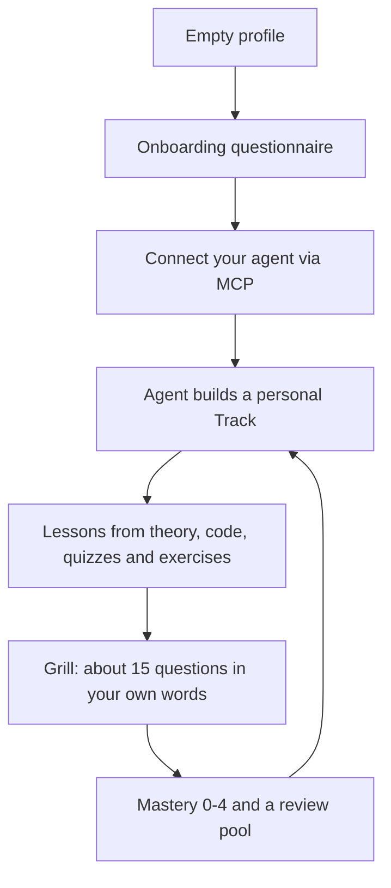

# Startodel

An open-source framework for a personal, agent-driven learning platform for experienced developers.

Startodel is not a catalog of ready-made courses. You bring your own AI agent. After a short onboarding questionnaire, the agent builds a personal Track: a graph of topics, in the style of [roadmap.sh](https://roadmap.sh), drawn from documentation, best practices, interview questions, or a GitHub repository.

You study Lessons made of typed blocks: theory, code, production callouts, links, YouTube, quizzes, and exercises. Grill sessions then ask about 15 questions in your own words; your agent judges the answers. Results update mastery from 0 to 4 for each topic and feed a spaced-repetition review pool, and the loop continues.

The project is free to use with your own agent. You can [self-host](#quick-start) it, or use the cloud at [startodel.ru](https://startodel.ru) with GitHub login.

**Status: early.** GitHub sign-in gives each user a private profile and tracks. An external agent can build track graphs, write lessons, record progress, and run grill sessions with a personal MCP token. After sign-in, answer three questions about your stack, goals and grade, then connect your agent or skip to the dashboard. Open a Track to explore prerequisites and select a Topic. Its Lessons support reading, scored Quizzes and Exercises with hints and solutions.

- Cloud: [startodel.ru](https://startodel.ru)
- [Connect your agent](#connect-your-agent)
- [Agent guide](docs/agent-guide/README.md)
- [Roadmap](#roadmap)
- [Documentation](docs/README.md)

## Learning loop



## Features

- **Personal Tracks as a topic graph.** Topics live in your catalog, deduplicated by slug, and can be shared across tracks. A track may list sources such as a GitHub repository or documentation links.
- **Lessons from typed blocks.** Theory (Markdown), code, callouts (gotchas, production notes, tips), documentation links, YouTube videos, short quizzes, and exercises.
- **Grill sessions.** About 15 questions, with priority for weak topics and due reviews. Answers can come from the site or through MCP; your agent records the verdict.
- **Mastery and review.** Each topic has a mastery level from 0 (don't know) to 4 (internals), plus a Leitner-style review pool.
- **Bring your own agent.** Per-user MCP tokens, hashed at rest. The agent sees only its owner's data. Start with `get_guide` for a state-aware next step.
- **Self-hosted or cloud.** MIT licensed. The cloud at [startodel.ru](https://startodel.ru) already has GitHub login and a deployed database.

## Practice in the web app

The dashboard’s **Next up** card follows the same priorities as `get_guide`. Open **Grills** to answer one question at a time, read your agent’s feedback and find Lessons for Topics to reinforce. **Reviews** shows due Topics and the next seven days. Take a Practice Quiz when the Topic has a Quiz, or copy a prompt for your agent. **Progress** shows Mastery across your catalog, Track completion, Lessons read and recent Activity.

## Stack

The pnpm workspace contains the Nuxt 4 web app, the framework-free domain types in `@startodel/core`, and the Drizzle ORM schema, migrations, and client factory in `@startodel/db`. Authentication uses nuxt-auth-utils with GitHub OAuth. The MCP server uses `@modelcontextprotocol/sdk` over Streamable HTTP. Vite+ provides linting, formatting, and tests. The production image is Docker, deployed with Dokploy.

## Roadmap

Work is grouped by [milestones](https://github.com/startodel/startodel/milestones): Foundation, Learning core, Learning UI, and Agent skills.

### Done

- [x] Monorepo skeleton ([#1](https://github.com/startodel/startodel/pull/1))
- [x] PostgreSQL and Drizzle schema ([#2](https://github.com/startodel/startodel/pull/2))
- [x] GitHub login and per-user isolation ([#3](https://github.com/startodel/startodel/pull/3))
- [x] MCP server with per-user tokens ([#4](https://github.com/startodel/startodel/pull/4))
- [x] Production Docker image and deploy to [startodel.ru](https://startodel.ru) ([#5](https://github.com/startodel/startodel/pull/5))
- [x] Learning core data model: topic graph, lessons, mastery, reviews, grill sessions ([#6](https://github.com/startodel/startodel/pull/6))
- [x] MCP tools for the learning core and the agent guide ([#7](https://github.com/startodel/startodel/pull/7))
- [x] Onboarding, dashboard, Track Graph, and Lesson pages ([#15](https://github.com/startodel/startodel/issues/15))
- [x] Grill, progress, and reviews in the UI ([#16](https://github.com/startodel/startodel/issues/16))

### Next

- [ ] Agent skills in `packages/skills`, generated from `docs/agent-guide` ([#17](https://github.com/startodel/startodel/issues/17))

Later: [import topic graphs from roadmap.sh](https://github.com/startodel/startodel/issues/18), a [stream overlay page](https://github.com/startodel/startodel/issues/19) for the current plan, and a [server-side model as a paid option](https://github.com/startodel/startodel/issues/20).

## Quick start

From the repository root, install the pinned Node.js and pnpm versions, then start the local PostgreSQL database and Nuxt.

```sh
nvm install
npm install --global pnpm@12.23.0
pnpm install
cp .env.example .env
```

In GitHub Settings, open **Developer settings → OAuth apps → New OAuth App**. Set the homepage to `http://localhost:3000` and the authorization callback URL to `http://localhost:3000/auth/github`. Register the app, generate a client secret, and put its values in `NUXT_OAUTH_GITHUB_CLIENT_ID` and `NUXT_OAUTH_GITHUB_CLIENT_SECRET` in the root `.env`. Set `NUXT_SESSION_PASSWORD` there to a random value of at least 32 characters, such as the output of `openssl rand -base64 32`. [GitHub OAuth App registration](https://docs.github.com/en/apps/oauth-apps/building-oauth-apps/creating-an-oauth-app)

Load the settings into the environment before starting the workspace app.

```sh
set -a
. ./.env
set +a
docker compose up -d --wait
pnpm db:migrate
pnpm dev
```

Open [the home page](http://localhost:3000) or request [the health endpoint](http://localhost:3000/api/health). The endpoint returns HTTP 200 with `{"ok":true,"db":"up"}` when PostgreSQL answers `select 1`, or `{"ok":false,"db":"down"}` when the URL is missing or the connection fails.

To run the migration and isolation tests, set `DATABASE_URL_TEST` to a dedicated PostgreSQL test database and run `pnpm test`. The suite applies the migrations, creates two Users, and exercises the built app with sealed cookies issued through a local GitHub stand-in. The database-backed tests skip when the variable is unset.

## Deploy

Run Startodel as a single Docker image with a separate PostgreSQL database. The [deployment guide](docs/deploy.md) covers Docker, Dokploy, HTTPS, GitHub sign-in and startup migrations.

## Connect your agent

1. Sign in to Startodel. On **Connect your agent** or in **Settings → MCP tokens**, enter a name for your agent and select **Create token**. Copy the MCP Token while it is visible.
2. Set your MCP client's transport to **Streamable HTTP** and copy the MCP URL from the page (`https://<host>/mcp`). Send `Authorization: Bearer <token>` on every request.
3. Connect and start with `get_guide`. It reads your current learning state and suggests the next step, from completing your onboarding questionnaire to reviewing a due topic.
4. To remove access, select **Revoke** beside the matching name and prefix. To replace a lost MCP Token, revoke it and create another.

Read the [agent guide](docs/agent-guide/README.md) or open individual sections as MCP resources under `startodel://guide/<section>`. Each tool acts for the owner of the MCP token.

| Workflow             | Tools                                                                                                                                                 |
| -------------------- | ----------------------------------------------------------------------------------------------------------------------------------------------------- |
| Guidance and Profile | `get_guide`, `get_profile`, `update_profile`                                                                                                          |
| Tracks               | `create_track`, `get_track`, `update_track`, `list_tracks`                                                                                            |
| Topic Catalog        | `upsert_topics`, `list_topics`, `get_topic`                                                                                                           |
| Track Graph          | `add_edges`, `remove_edge`, `attach_topics_to_track`, `detach_topic_from_track`, `get_track_graph`                                                    |
| Lessons              | `create_lesson`, `update_lesson`, `get_lesson`, `list_lessons`                                                                                        |
| Progress             | `get_progress`, `set_mastery`, `record_quiz_result`, `mark_lesson_read`                                                                               |
| ReviewItems          | `list_due_reviews`, `record_review_result`                                                                                                            |
| GrillSessions        | `start_grill`, `get_grill_candidates`, `add_grill_questions`, `get_grill`, `list_grills`, `submit_grill_answer`, `judge_grill_answer`, `finish_grill` |

For clients that use the editor-managed `mcp.json` format, replace the example host below and enter the MCP Token at the password prompt. [Client configuration reference](https://code.visualstudio.com/docs/agents/reference/mcp-configuration#_input-variables-for-sensitive-data)

```json
{
  "servers": {
    "startodel": {
      "type": "http",
      "url": "https://startodel.example/mcp",
      "headers": { "Authorization": "Bearer ${input:startodel-token}" }
    }
  },
  "inputs": [
    {
      "id": "startodel-token",
      "type": "promptString",
      "description": "Startodel MCP Token",
      "password": true
    }
  ]
}
```

## Contributing

See the [contribution guide](CONTRIBUTING.md). Issues and pull requests are welcome.

## License

[MIT](LICENSE)
